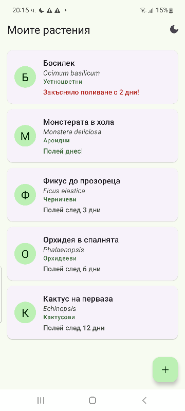
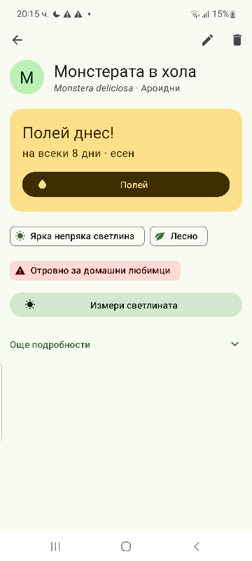
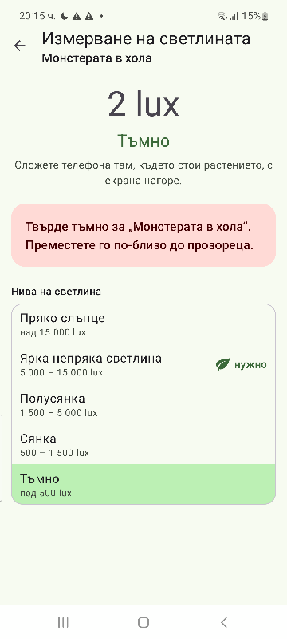
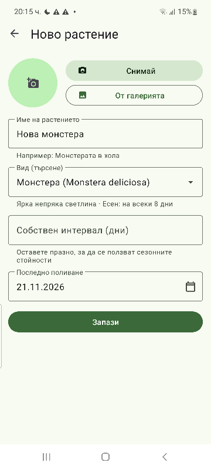
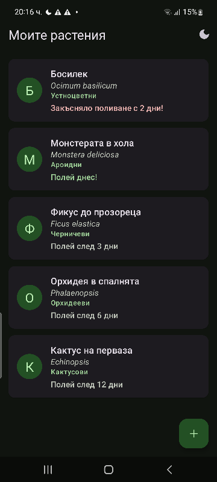
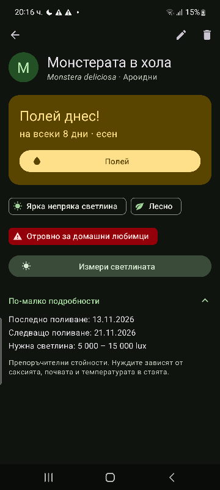

# PlantCare

Андроид приложение за грижи за стайни растения. То показва кога да полееш всяко растение в зависимост от вида и сезона, а със светлинния сензор на телефона проверява дали растението е на подходящо място.

| | |
|---|---|
| **Дисциплина** | Мобилни приложения |
| **Автор** | Naim Abaz, ФН 2401321010 |
| **Платформа** | Android 7.0+ (API 24), Kotlin |
| **APK** | [`apk/app-release.apk`](apk/app-release.apk) |

## Съдържание

1. [Идея](#идея)
2. [Как функционира](#как-функционира)
3. [Архитектура](#архитектура)
4. [Потребителски поток](#потребителски-поток)
5. [Стъпки за стартиране](#стъпки-за-стартиране)
6. [Тестови акаунти](#тестови-акаунти)
7. [Скрийншотове](#скрийншотове)
8. [APK](#apk)

## Идея

Имам много растения и обичам да се грижа за тях, така че се замислих, че често забравям, както и много други хора, когато са ги поливали или ги поливат по същия начин през цялата година. Всяко растение има обаче различни нужди: кактусът иска вода приблизително на всеки две седмици, а босилекът на ден-два и тези нужди се променят според сезона.

PlantCare поддържа списък с растенията на потребителя и за всяко показва кога трябва да се полее. Приложението знае за 104 често срещани стайни растения и подправки, разделени на 45 ботанически семейства. За всеки вид има период на поливане за всеки сезон, нужна светлина, сложност на отглеждане и информация дали е отровен за домашни любимци.

Основни функции:

- списък „Моите растения“, подреден по нужда от поливане – първо закъснелите, после тези за днес и накрая останалите;
- добавяне, преглед, редактиране и изтриване на растения (пълен CRUD);
- търсене на вид по част от името – на български по ежедневното им наименувание или на латински, т.е. научното име;
- снимка на растението от камерата или от галерията;
- бутон „Полей“ с възможност за отмяна;
- светломер, който използва сензора за светлина на телефона;
- светла и тъмна тема (Material 3) с превключвател в приложението;
- отделен хоризонтален изглед за списъка, формата и светломера.

## Как функционира

### Данни и първо стартиране

Данните се пазят в локална база Room (`plantcare.db`) с три таблици:

| Таблица | Съдържание |
|---|---|
| `plants` | растенията на потребителя – име, вид, дата на последно поливане, собствен интервал, път до снимката |
| `plants_cat` | 45 ботанически семейства (напр. Ароидни – Araceae) с интервал на поливане по подразбиране |
| `plant_species` | 104 вида с интервал за всеки сезон, нужна светлина, трудност и токсичност |

При първото стартиране базата се създава и попълва автоматично. Семействата са описани в `PlantCareDatabase`, а видовете се четат от `app/src/main/assets/plant_species.csv` чрез `SpeciesCsvParser`. Списъкът с растения започва празен. Всички промени се запазват и след рестарт на приложението или на телефона.

### Изчисляване на поливането

За всяко растение `WateringCalculator` определя интервала в дни в този ред:

1. собственият интервал, ако потребителят е въвел такъв (от 1 до 90 дни);
2. интервалът на вида за сезона, в който е последното поливане (пролет: март–май, лято: юни–август, есен: септември–ноември, зима: декември–февруари);
3. интервалът по подразбиране на семейството;
4. 7 дни, ако растението няма нито вид, нито семейство.

**Следващо поливане = последно поливане + интервал.** Спрямо днешната дата растението получава статус „Полей след N дни“, „Полей днес!“ или „Закъсняло поливане с N дни!“. В детайлите картата със статуса е зелена, жълта или червена според това колко спешно е поливането. Списъкът е подреден по датата на следващото поливане, а растенията с еднаква дата – по азбучен ред.

Бутонът „Полей“ записва днешната дата като последно поливане, а „Отмени“ връща предишната.

### Светломер

Екранът „Измерване на светлината“ използва сензора `Sensor.TYPE_LIGHT`. Слушателят се регистрира в `onResume()` и се премахва в `onPause()`, така че сензорът работи само докато екранът е отворен. За да не скача числото, се показва средното от последните 5 измервания. Стойността в lux се превръща в ниво:

| Ниво | Lux |
|---|---|
| Тъмно | под 500 |
| Сянка | 500 – 1 500 |
| Полусянка | 1 500 – 5 000 |
| Ярка непряка светлина | 5 000 – 15 000 |
| Пряко слънце | над 15 000 |

Измереното ниво се сравнява с нуждата на вида (`LightCheck`) и се показва съвет: „Подходящо място“, „Твърде тъмно“ или „Твърде светло“. Ако телефонът няма сензор за светлина, се показва съобщение за това.

### Снимки

Снимката се прави през приложението за камера на телефона (`ActivityResultContracts.TakePicture` и `FileProvider`) или се избира от галерията чрез системния избор на снимки (`PickVisualMedia`). Файлът се пази във вътрешната памет на приложението (`files/photos`) и се зарежда с Coil. Заменените и неизползваните снимки се изтриват автоматично.

### Валидация

Формата за растение използва `Validatable` и `ValidationRule` с регулярни изрази:

- име от 2 до 40 знака (букви, цифри и основна пунктуация);
- вид, избран от списъка;
- собствен интервал от 1 до 90 дни (по желание);
- дата на последно поливане, която не е в бъдещето.

### Тема и разрешения

Темата е Material 3 DayNight. От иконата с луна на главния екран се избира „Като системата“, „Светла“ или „Тъмна“. Изборът се пази в `SharedPreferences` и се прилага при стартиране в `PlantCareApp`.

Приложението не изисква разрешения: камерата се отваря чрез Intent, снимките от галерията минават през системния избор, а сензорът за светлина не изисква разрешение. В манифеста сензорът е обявен като незадължителен (`android.hardware.sensor.light`, `required="false"`).

## Архитектура

Приложението следва **MVVM + Repository** с ръчно **Dependency Injection**.

```
PlantCareApp ──► AppContainer (DI): PlantRepository, PhotoStorage, ThemeSettings
                     │
                     ▼
Activity (XML изглед, findViewById)
   │  наблюдава LiveData и извиква методи
   ▼
ViewModel (+ ViewModelProvider.Factory)
   │
   ▼
PlantRepository
   │
   ▼
DAO: PlantDao, CategoryDao, SpeciesDao
   │
   ▼
Room: PlantCareDatabase (plantcare.db)
```

- **UI** – Activity класове с XML изгледи (`findViewById`, `lateinit`), `ListAdapter` + `DiffUtil` за списъка, компоненти на Material 3 и `layout-land` изгледи със същите ID-та.
- **ViewModel** – пази състоянието в `LiveData` и оцелява при завъртане на екрана. Създава се през `Factory`, която получава хранилището отвън.
- **Repository** – `PlantRepository` е единственият достъп до данните за ViewModel-ите.
- **DI** – `PlantCareApp` създава един `AppContainer` при стартиране. Activity класовете взимат зависимостите от него и ги подават на `Factory`. Благодарение на това unit тестовете подменят DAO-тата с фалшиви (`FakeDaos.kt`).
- **Логика** – `WateringCalculator`, `Season`, `LightCheck` и `LightLevel` не зависят от Android и се тестват директно.

### Структура на пакетите

```
com.naim.plantcare
├── PlantCareApp.kt      Application – създава AppContainer
├── di/                  AppContainer (ръчно DI)
├── data/                Room база, конвертори, CSV парсер, съхранение на снимки
│   ├── dao/             PlantDao, CategoryDao, SpeciesDao
│   ├── entity/          Plant, PlantCategory, PlantSpecies, LightLevel, Difficulty
│   └── repository/      PlantRepository
├── logic/               WateringCalculator, Season, LightCheck
├── settings/            ThemeMode, ThemeSettings
├── validation/          Validatable, ValidationRule
└── ui/
    ├── list/            MainActivity, PlantAdapter, PlantListViewModel
    ├── detail/          PlantDetailActivity, PlantDetailViewModel
    ├── add/             AddPlantActivity, AddPlantViewModel, SpeciesAdapter
    └── light/           LightMeterActivity, LightMeterViewModel
```

### Технологии

| Област | Използвано |
|---|---|
| Език и build | Kotlin 2.2, Android Gradle Plugin 9.5, KSP |
| SDK | minSdk 24, targetSdk 37 (core library desugaring за `java.time` на Android 7) |
| Данни | Room 2.7 |
| Архитектура | Lifecycle 2.8 (ViewModel, LiveData) |
| UI | Material Components 1.13 (Material 3), RecyclerView, ConstraintLayout |
| Тестове | JUnit 4, Espresso 3.6, Room in-memory база |

## Потребителски поток

```
Моите растения ──(+)──► Ново растение ──(Запази)──► Моите растения ──(растение)──► Детайли ──► Измерване на светлината
```

1. При първо стартиране списъкът „Моите растения“ е празен.
2. Бутонът „+“ отваря „Ново растение“: снимка (по желание), име, вид (търсене по част от името), собствен интервал (по желание) и дата на последно поливане. „Запази“ записва растението.
3. Растението се появява в списъка със статус и на мястото си според нуждата от поливане.
4. Докосване на растение отваря детайлите: статус и бутон „Полей“, нужна светлина, трудност, предупреждение за отровност и „Още подробности“ (дати и нужни lux).
5. „Измери светлината“ отваря светломера, който показва дали мястото е подходящо за това растение.
6. Иконата с молив отваря същата форма като „Редактиране на растение“, а иконата с кошче изтрива растението след потвърждение.
7. В списъка растение се изтрива и с плъзгане настрани; „Отмени“ го връща.
8. Иконата с луна на главния екран сменя темата.

## Стъпки за стартиране

### Изисквания

- Android Studio (последна стабилна версия) с вграденото в нея JDK
- телефон или емулатор с Android 7.0 (API 24) или по-нов

### От Android Studio

1. Клонирайте хранилището:
   ```bash
   git clone https://github.com/Zzznai/MobileApps2025-2401321010.git
   ```
2. **File → Open** и изберете папката на проекта. Изчакайте Gradle Sync да приключи.
3. Изберете устройство и натиснете **Run** (конфигурация `app`).

### От командния ред

```bash
./gradlew assembleDebug                      # debug APK в app/build/outputs/apk/debug/
./gradlew testDebugUnitTest                  # unit тестове
./gradlew createDebugUnitTestCoverageReport  # покритие: app/build/reports/coverage/test/debug/index.html
./gradlew connectedDebugAndroidTest          # UI тестове (Espresso) на свързано устройство
./gradlew :app:detekt                        # стил на кода: app/build/reports/detekt/detekt.html
```

На Windows се използва `gradlew.bat` вместо `./gradlew`. След `connectedDebugAndroidTest` Gradle деинсталира приложението от устройството, така че записаните там растения се изтриват.

### Тестове

| Вид | Брой | Какво проверяват |
|---|---|---|
| Unit (JUnit 4) | 82 | изчисляване на поливането и сезоните, каталога с видове, валидацията, ViewModel-ите (с фалшиви DAO), подредбата, светломера и темата |
| Room (инструментални) | 5 | запис, четене, обновяване и изтриване в базата (в паметта) |
| UI (Espresso) | 4 | основният сценарий – добавяне на растение, намирането му в списъка и отваряне на детайлите, както и валидацията на формата |

Unit тестовете покриват над 15% от всички редове, включително UI кода и генерирания от Room код. Пакетите с логика (`logic`, `data/entity`) са покрити 100%, а `PlantRepository` – 92%.

## Тестови акаунти

Не са необходими. Приложението няма регистрация и вход – всички данни се пазят локално на устройството.

## Скрийншотове

Снимките са от Samsung Galaxy A52 (Android 12) с примерни растения.

| Моите растения | Детайли за растение |
|---|---|
|  |  |
| **Измерване на светлината** | **Ново растение** |
|  |  |
| **Тъмна тема – списък** | **Тъмна тема – детайли** |
|  |  |

## APK

Готовият за инсталиране файл е [`apk/app-release.apk`](apk/app-release.apk) – release build, подписан с ключа на мое име, около 6,3 MB.

1. Копирайте файла на телефона или го изтеглете от GitHub.
2. Отворете го и разрешете инсталиране от този източник, ако телефонът попита.
3. Нужен е Android 7.0 или по-нов.

### Подпис и парола

- **За инсталиране не е нужна парола.** APK файлът се инсталира на всеки телефон без парола и без акаунт.
- **Защо е подписан.** Android инсталира само подписани приложения. Подписът показва кой е създал приложението и гарантира, че файлът не е променян след подписването.
- **Обновяване.** Android приема нова версия върху вече инсталираното приложение само ако е подписана със същия ключ. Debug версията от Android Studio е подписана с друг ключ, затова ако тя е на телефона, първо я деинсталирайте.
- **Кога трябва паролата.** Само при създаване на нов подписан APK (**Build → Generate Signed App Bundle or APK**). Файлът с ключа (`.jks`) и паролата се пазят само при автора и не са качени в хранилището – `.gitignore` изключва `.jks` файловете.
